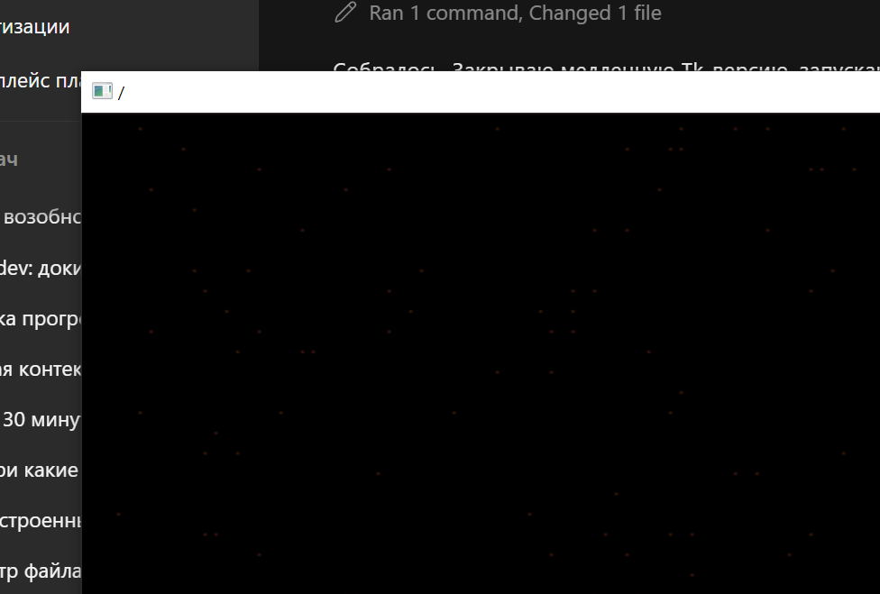
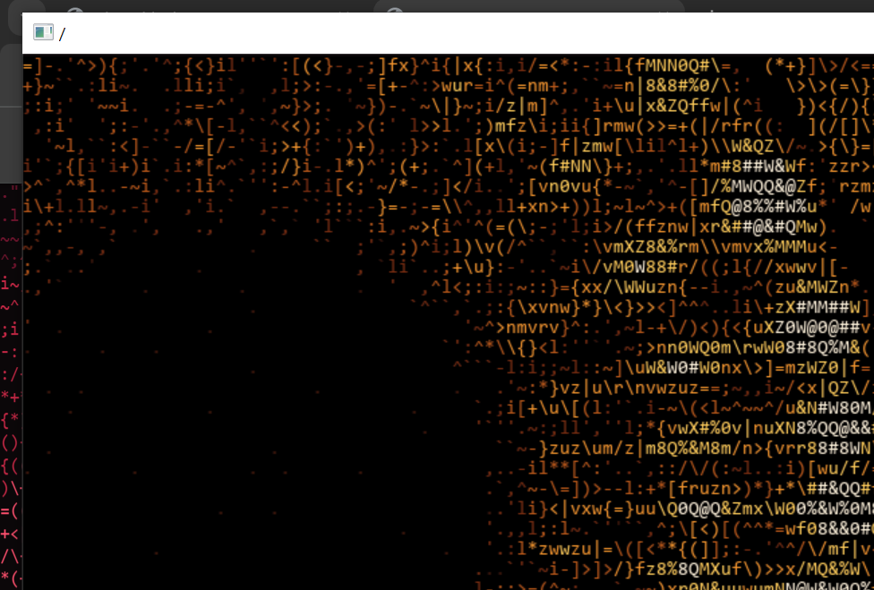

# ascii-zoom

Портфолио-проект: одна идея — три реализации. Анимация «глаз → зум в зрачок →
сфера из шума» набрана целиком текстовыми символами, без картинок и видео.

По мотивам видео [@ch20f3rst](https://www.tiktok.com/@ch20f3rst) (TikTok) — идея
и визуальный референс его, код и порты мои.

## Что внутри

| Реализация | Стек | Где |
|---|---|---|
| **Веб (демо)** | React 18 + Vite, канвас с сеткой знакомест | [`web/`](web/) — [живая демка](https://snowxdxaxd.github.io/ascii-zoom/) |
| **Text warp** | React 18 + Vite, динамический деформируемый текст | [`text-warp/`](text-warp/) — [/text-warp](https://snowxdxaxd.github.io/ascii-zoom/text-warp/) |
| **Rust-порт** | Rust, рендер в терминал/окно | [`rust/`](rust/) |
| **Python-прототип** | Tkinter-канвас | [`python/`](python/) |

## Скриншоты





## Почему три реализации

Прототип на Python собран за вечер и подтвердил идею. Rust-порт — чтобы
выжать кадры из терминала и получить нативную скорость. Веб-версия — чтобы
показать кому угодно по ссылке без установки чего-либо. Каждая реализация
проверяла своё: прототип — концепцию, Rust — производительность, веб —
доставку.

## Запуск локально

```bash
# веб
cd web && npm ci && npm run dev

# text-warp
cd text-warp && npm ci && npm run dev

# rust
cd rust && cargo run --release

# python (нужен tkinter)
cd python && python main.py
```

## Деплой

GitHub Actions собирает оба веб-приложения и выкатывает на GitHub Pages
(`.github/workflows/deploy-pages.yml`): ascii-zoom в корень, text-warp в
подпуть `/text-warp/`.

---
Автор: [Snowxdxaxd](https://github.com/Snowxdxaxd) · полный стек: TypeScript,
React, Rust, Python, CI/CD.
